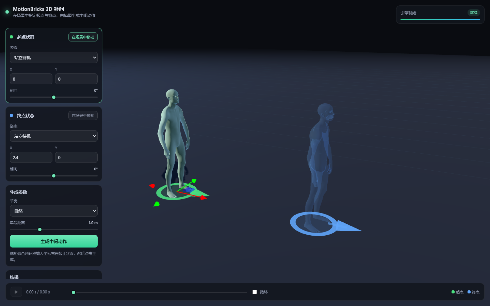
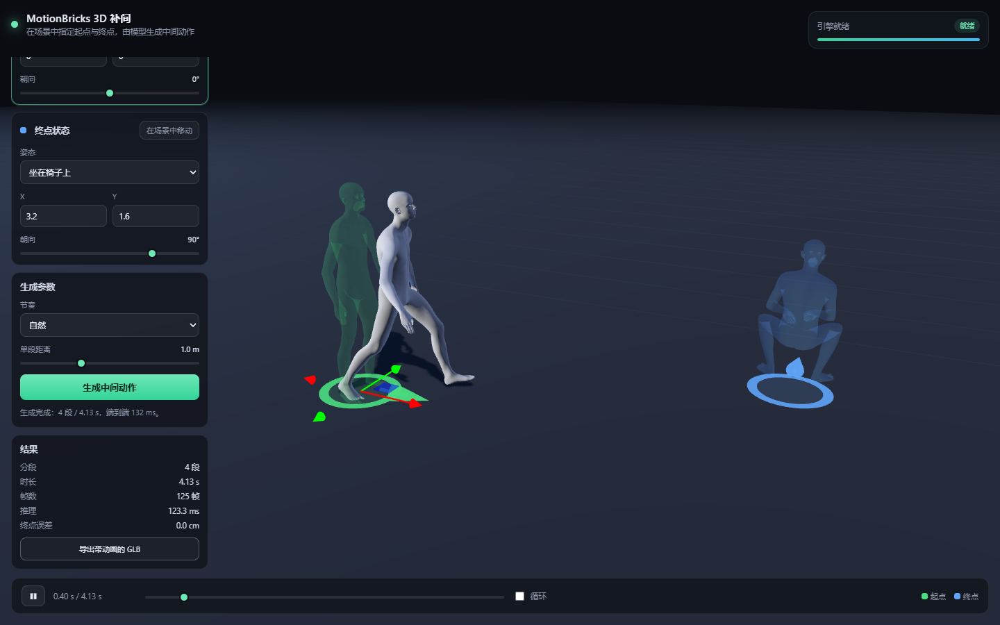
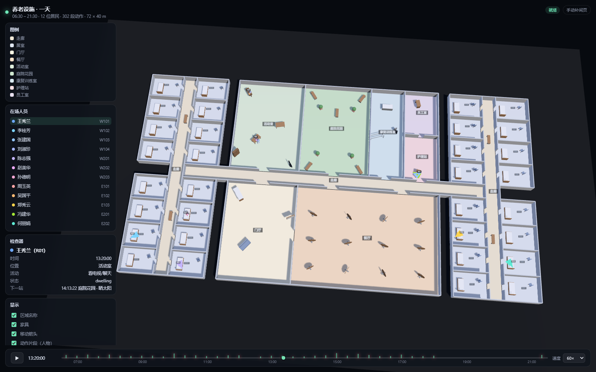

# MotionBricks Web 3D 补间

把 [NVlabs/MotionBricks](https://github.com/NVlabs/motionbricks) 从桌面 ImGui/Newton 演示，改造成一个**浏览器 3D 场景里的起止姿态补间工具**：在场景中用彩色圆环摆出「起点状态」和「终点状态」，点击一个按钮，模型生成中间的动作，浏览器里直接播放，并可导出带动画的 GLB。



## 一分钟上手

双击 `start.bat`（或按下面的命令行方式启动），浏览器会打开 <http://127.0.0.1:8000>。

1. 绿色圆环 = 起点，蓝色圆环 = 终点。拖动圆环或用左侧输入框改位置，用「朝向」滑块改朝向。
2. 用「姿态」下拉框给两端分别选一个身体姿态（站立 / 蹲伏 / 坐下 / 行走 / 奔跑 / 跳起 / 舞蹈 …）。
3. 选「节奏」和「单段距离」，点「生成中间动作」。
4. 底部时间轴可播放 / 暂停 / 拖动 / 循环；「导出带动画的 GLB」可把这段动作拿到 Blender、three.js 或 Unity 里继续用。



## 另一个页面：养老设施的一天（`/day`）

在同一个工程里还加了一层研究场景：把一套 72 × 40 m 的养老设施（42 个房间/区域、102 件家具）
和 12 位居民 + 3 名员工的一天搬进 3D，时间轴可拖动回放。
**只有状态跃迁的时刻**（落座、起身、相遇、告别、13:20 的胸痛事件）才调用 MotionBricks 生成动作，
其余时间用地面箭头表示——307 段动作整批生成只要 2.1 秒。

```powershell
python -m webapp.sim.build     # 从 demo/ 的一天数据生成场景与动作片段
# 打开 http://127.0.0.1:8000/day
```



细节见 [docs/DAY_SCENE.md](docs/DAY_SCENE.md)。

## 目录结构

```
motionbricks-web/
├─ motionbricks/          # 官方仓库（浅克隆 + git lfs，含 ONNX 模型、BVH 动作、SOMA USD）
├─ webapp/                # 本次改造的 Web 应用
│  ├─ poses.py            # 12 个预设姿态：BVH 采样 → 标准化（根节点归零、朝向标定）
│  ├─ motion.py           # 生成服务：4 帧 context + 1 帧 target，远距离自动链式分段
│  ├─ glb_export.py       # SOMA USD → GLB（骨架 + 蒙皮权重 + 逆绑定矩阵，Y-up→Z-up）
│  ├─ server.py           # FastAPI：/api/scene、/api/pose、/api/generate、/ws
│  ├─ cli.py              # 无浏览器命令行生成（调试与批量用）
│  └─ static/             # 前端：three.js 场景、gizmo、播放器（three r160 已本地化）
├─ tests/                 # 冒烟 / 质量 / 浏览器端到端测试与截图
├─ docs/images/           # 文档截图
├─ start.bat              # 一键启动
└─ README.md
```

## 环境

已在本机创建 conda 环境 **`motionbricks`**（Python 3.12.16）：

| 组件 | 版本 | 说明 |
| --- | --- | --- |
| Python | 3.12.16 | 官方要求 `>=3.12`（`.python-version` = 3.12） |
| warp-lang | 1.19.0 | 运行时内核（JIT 编译，自带 CUDA 13.4 toolkit，无需另装 nvcc） |
| tensorrt / bindings / libs | 10.8.0.43 | 与仓库 `pyproject.toml` 钉的版本一致 |
| newton | 1.6.0 | 官方依赖（本 Web 应用不加载 Newton viewer） |
| usd-core | 26.3 | 读取 SOMA 的 `.usd` 角色 |
| numpy / scipy | 2.4.3 / 1.17.1 | 官方钉的版本 |
| fastapi / uvicorn | 0.162.0 / 0.54.0 | Web 服务 |

**重建环境**（换机器时）：

```powershell
conda create -y -n motionbricks -c conda-forge --override-channels python=3.12
conda activate motionbricks
git clone https://github.com/NVlabs/motionbricks.git
git -C motionbricks lfs install --local
git -C motionbricks lfs pull          # 必须！ONNX/BVH/USD/STL 都是 LFS 指针
pip install -e motionbricks
pip install fastapi "uvicorn[standard]" playwright
python -m webapp.glb_export           # 首次生成 webapp/static/soma.glb
```

> 注意：`git clone` 若因网络中断失败，用 `GIT_LFS_SKIP_SMUDGE=1 git clone --depth 1` 再 `git lfs pull`。
> 工作目录请放在**纯 ASCII 路径**（本机为 `C:\Users\13119\Desktop\framework\motionbricks-web`），中文路径有概率让 LFS / TensorRT 出错。

## 启动

```powershell
# 方式一：双击 start.bat

# 方式二：命令行
cd C:\Users\13119\Desktop\framework\motionbricks-web
C:\Users\13119\anaconda3\envs\motionbricks\python.exe -m uvicorn webapp.server:app --host 127.0.0.1 --port 8000
```

服务启动后 `http://127.0.0.1:8000/api/status` 返回 `{"state":"ready"}` 即就绪。
首次运行（或换精度、换 batch）会构建 TensorRT plan，**约 1 分钟**，之后从 `motionbricks/.trt-cache/` 秒级加载。
服务启动末尾会做一次**预热生成**（烘焙 CUDA graph），所以第一次点「生成」不会有额外的捕获开销，也不会踩到捕获瞬间的偶发竞态。

## 它是怎么工作的

MotionBricks 的原生接口是：**4 帧上下文（context）+ 1–4 帧目标（target）→ 18–58 帧、约 0.6–1.9 秒的动作**，一次生成覆盖不了长距离。本应用在它外面包了两层：

```
浏览器 (three.js, Z-up)                 服务端 (FastAPI, 同进程调模型)
┌───────────────────────┐    HTTP     ┌──────────────────────────────────────┐
│ 起点/终点圆环 + 姿态幽灵 │ ─────────▶ │ 1. 姿态库：BVH 采样 → 根节点归零/朝向标定 │
│ 播放器 (30Hz, 插值)     │            │ 2. 起点复制 4 帧作 context              │
│ 时间轴 / 导出 GLB       │ ◀───────── │ 3. 路径按 1.0 m 切段，逐段生成           │
└───────────────────────┘  帧数据流   │ 4. 每段末 4 帧喂给下一段（链式接续）      │
                                     │ 5. 末段 target = 终点姿态（精确收尾）     │
                                     └──────────────────────────────────────┘
```

关键点：

- **坐标**：SOMA 模型空间是 Y-up，运行时装换到 Z-up（MUJOCO 约定，`R = +90° about X`）。浏览器也用 Z-up（`camera.up = (0,0,1)`），前后端同一套坐标，没有额外转换。
- **姿态库**：从 `motionbricks/assets/motions/soma` 的 BVH 里按时间点采样，然后把根节点的 yaw 归零、水平位置归零，得到一个「站在原点、朝 +X」的标准姿态；朝向偏移由腿部关节（`SOMA_N1_HEADING_JOINTS`）实测标定，因此 UI 的「朝向 90°」对每个姿态都一致。
- **链式分段**：距离 ≤ 1 m 时一次生成；更远则按「单段距离」切分，中间段用行走姿态做 target，**最后一段**才用终点姿态，于是动作既连续又精确收在终点上（实测终点位置误差 0.0 cm、姿态误差 < 0.05°）。
- **节奏**：模型的 `allowed_token_counts` 决定单段时长（6–16 token ≈ 18–58 帧）。同样 1 m 距离，token 越少走得越快，所以 UI 的「快 / 自然 / 慢」直接映射到 token 集合。
- **蒙皮**：浏览器里用真正的 SOMA 蒙皮网格（18056 顶点 / 77 关节 / 每顶点最多 4 个骨骼权重），由 `glb_export.py` 从 USD 导出，包含逆绑定矩阵，与运行时的 `world × IBM` 蒙皮公式完全一致。

## HTTP 接口

| 方法 | 路径 | 说明 |
| --- | --- | --- |
| GET | `/api/status` | `state`（starting / loading / building / ready / error）、进度、消息 |
| GET | `/api/scene` | 骨架关节名、12 个姿态、GLB 地址、fps |
| GET | `/api/pose/{key}` | 单个标准姿态（base64 float32，`[joints,7]`）+ `forwardYaw` + `rootHeight` |
| POST | `/api/generate` | 生成动作，见下 |
| WS | `/ws` | 引擎构建进度推送 |

`POST /api/generate` 请求：

```json
{
  "startPose": "idle", "start": [0, 0], "startHeading": 0,
  "endPose": "sit",   "end": [3.2, 1.6], "endHeading": 90,
  "pace": "normal", "step": 1.0
}
```

响应包含：`frames`（base64 float32，`[frames, joints, 7]`，每关节 XYZ + XYZW）、`numFrames`、`duration`、`segments[]`（每段帧数与推理耗时）、`rootPath`、`elapsedMs`。

命令行等价用法：

```powershell
python -m webapp.cli --start idle --end sit --end-xy 3.2 1.6 --end-heading 90 --pace fast --out tests/out.npz
```

## 本机实测性能（RTX 5060 Ti 16GB，驱动 610.88 / CUDA 13.3）

| 指标 | 数值 |
| --- | --- |
| TensorRT plan 首次构建 | 约 60 s（含 Warp JIT），plan 文件 766 MB，缓存在 `motionbricks/.trt-cache/` |
| 单段推理（SOMA FP32，batch 1） | 3.5 – 5.4 ms |
| 4 段 / 4.1 s 动作，端到端（预热后） | **21 ms 推理 / 30 ms 端到端** |
| 4 段 / 4.1 s 动作，冷启动首次请求 | 130 – 230 ms（含 CUDA graph 预热） |
| 8 m 距离（8 段 / 6.7 s） | 约 60 ms 生成 + 8 段推理 |
| 浏览器播放 | 30 Hz 数据，60 fps 插值渲染 |

## 验证

```powershell
python -m tests.smoke_warp                       # Warp 内核 + sm_120
python -m tests.check_motion --end sit --end-xy 2.5 2.5 --end-heading 90
python -m tests.e2e                              # 浏览器端到端：改状态→生成→导出 GLB
```

`check_motion` 会输出：根节点逐帧位移（>0.25 m/帧 视为跳变）、最低脚点高度、支撑脚滑移、首末帧与请求状态的误差、单帧最大关节转角。

最近一次结果（走到坐姿，2.5 m + 90° 转向）：

```
frames=125 duration=4.13s segments=4
root step  mean=0.0286 m/frame  max=0.0680 m
lowest foot point z=-0.029 m
first frame vs start state: max position 0.0000 m, max rotation 0.04 deg
last frame  vs end state:   max position 0.0000 m, max rotation 0.05 deg
max joint rotation per frame: 14.6 deg
```

## 已知限制

1. **脚底滑步**：模型是纯运动学生成，没有物理求解或足部 IK，支撑脚可能有 0.2–1 m/s 的滑移；需要完全贴地时可在 `TargetPoseInferenceParams` 打开 `ik_pin_mask`（SOMA 支持手脚两骨 IK），本版本未接入 UI。
2. **不做路径规划**：中间路径是「朝终点直线前进 + 自动分段」，不会绕障碍；需要绕行时请加中间航点（当前版本未提供多航点 UI）。
3. **单次生成长度固定**：一段 0.6–1.9 s；长距离靠分段，段与段的衔接处极少数情况会有轻微节奏变化。
4. **姿态库只有 12 个**：来自仓库自带 BVH；要更多姿态，在 `webapp/poses.py` 的 `POSE_SPECS` 里加一行（clip 路径 + 采样时间）即可。
5. **只能跑在本机 GPU 上**：TensorRT + Warp 决定了推理必须在有 NVIDIA 显卡的机器上，浏览器只负责渲染，所以是「本地服务 + 浏览器」而不是纯前端方案。
6. **首次启动慢**：TensorRT 首次构建约 1 分钟；之后有缓存。
7. **SOMA 网格是仓库自带的简化骨架网格**，不是带服装的高模；换高模需要重新导出 GLB 并保证关节名一致。

## 排错

| 现象 | 处理 |
| --- | --- |
| 页面一直「构建引擎」 | 看控制台/服务端日志；首次构建属正常。GPU 被其它进程占满时会明显变慢 |
| `state: error`，TensorRT 报错 | 本机为 sm_120（Blackwell），TensorRT 10.8 可正常构建；若换卡失败，可把 `tensorrt-cu12*` 升到 10.9+，或改用 ONNX Runtime（见官方 `docs/onnx_inference.md`） |
| `git lfs pull` 后 ONNX 仍是 134 字节 | LFS 没拉全，重跑 `git -C motionbricks lfs pull`，或检查网络代理 |
| 端口 8000 被占用 | `--port 8010`，并同步改 `start.bat` |
| 画面空白但无报错 | 浏览器需支持 WebGL2；可先用 `python -m tests.ui_check` 看截图与控制台 |

## 许可

- `motionbricks/` 内代码：Apache 2.0；模型权重：NVIDIA Open Model Agreement；示例动作：NVIDIA Sample Data Evaluation License（详见仓库 `LICENSE` 与 `licenses/`）。
- `webapp/`、`tests/`、本 README：沿用 Apache 2.0。
- 前端 three.js r160：MIT。
