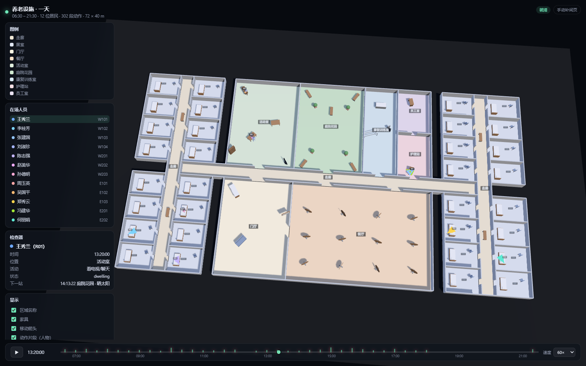

# 一天回放：养老设施 3D 场景 + 事件驱动动作生成

`/day` 页面把 `demo/`（养老服务设施 Agent 仿真）产出的一天搬进一个 72 × 40 m 的单层设施里：
**12 位居民 + 3 名员工**，06:30–21:30，时间轴可拖动。只有"状态跃迁"的时刻才由 MotionBricks 生成动作，
其余时间用地面箭头表示。



## 为什么只在交互时生成

MotionBricks 一次生成 0.6–1.9 s 的动作。一天 15 小时如果逐帧生成，需要几万次推理，没有意义。
真正需要"动作"的是**状态发生改变的瞬间**：

| 事件 | 判定 | 数量 |
|---|---|---|
| 落座 | 停留片段命中坐姿类活动，且停留点 3 m 内有同类型家具 | 121 |
| 起身 | 该停留片段结束 | 121 |
| 相遇 | 两人距离 < 1.5 m 持续 ≥ 15 s，且至少一人在走近 | 30 |
| 告别 | 同一次相遇结束 | 30 |
| 胸痛 | 13:20 固定剧本 | 5 |

合计 **307 段**，整批生成 **2.1 秒**（单段 3–6 ms），缓存后拖动时间轴零等待。
共处但静止的时段（同桌吃饭 40 分钟）不生成动作——人物保持坐姿，不做无意义的推理。

## 数据管线

```bash
python -m webapp.sim.build            # 全流程，约 25 s（含引擎加载）
python -m webapp.sim.build --no-clips # 只建场景与时间轴，秒级
```

| 步骤 | 模块 | 输入 → 输出 |
|---|---|---|
| 1 | `facility.py` | `demo/assets/mock_plan.json` → `facility.json`（42 区、98 段墙、42 门洞、102 家具） |
| 2 | `day.py` | `demo/runs/demo01/*.csv` → `day.json`（12 人 × 10801 采样、朝向、停留吸附家具） |
| 3 | `events.py` | `day.json` → `events.json`（落座/起身/相遇/告别 + 座位分槽） |
| 4 | `staff.py` | 排班表 + demo 的 A* 栅格 → `staff.json`（3 名员工轨迹） |
| 5 | `scenario.py` | 13:20 胸痛剧本 → 追加 5 个 beat，改写 N01/N02 当天轨迹 |
| 6 | `clips.py` | `events.json` → `clips.json` + `clips.bin`（307 段，37.6 MB） |

`demo/` **一行未改**，只读它的输出；员工路径复用 `eldercare.space.floorplan.FloorPlan.astar`，
所以不会穿墙。

## 胸痛事件（13:20 活动室）

| 时刻 | 谁 | 发生什么 | 动作 |
|---|---|---|---|
| 13:20:00 | R01 | 看电视时突发胸痛、捂住胸口 | `idle → grab_chest` |
| 13:20:20 | R01 | 扶胸蹲下 | `grab_chest → crouch` |
| 13:25:00 | N01 | 从护理站跑到身侧蹲下查看 | 路径 + `idle → crouch` |
| 13:27:00 | N02 | 第二名护理员到位 | 路径 + `idle → crouch` |
| 13:29:00 | R01 | 搀扶起身 | `crouch → idle` |

事件期间 R01 的原始轨迹被"冻结"在事件点；13:30 后恢复到记录轨迹继续活动。
时间轴上有红色标记，点一下直接跳到 13:20；左侧出现事件卡片列出全部 beat。

## 前端

| 文件 | 作用 |
|---|---|
| `static/day.html / day.css` | 独立页面，与手动补间页 `/` 互不影响 |
| `static/day.js` | three.js 场景、箭头/人物双模式、时间轴、检查器、事件卡片 |

- **箭头**：无动作时显示，指向瞬时速度方向，`depthTest:false` 所以不会被家具挡住。
- **人物**：动作片段生效期间显示 SOMA 蒙皮角色（77 关节），片段结束后若仍坐在原位则保持该姿势。
- **时间轴**：绿色柱状是动作片段密度（可点击），红色是胸痛事件，支持 1×–900× 播放。
- **检查器**：选中任意 Agent 显示此刻区域、活动、状态、下一站。

## 实测

| 指标 | 数值 |
|---|---|
| 动作片段 | 307 段 / 37.6 MB / 整批 2.1 s |
| 单段推理 | 3–6 ms |
| 场景数据 | 42 区 / 98 墙 / 42 门 / 102 家具 |
| 轨迹 | 12 人 × 10801 采样（5 s），129,612 点全部落在房型内 |
| 家具吸附 | 121/142 个停留片段，平均偏差 0.22 m（最大 0.78 m） |
| 帧率 | 15 Agent 同时渲染 **60 fps**（RTX 5060 Ti / D3D11 / 1440p） |
| 时间轴跳转 | 3–14 ms |
| 控制台错误 | 0 |

## 已知限制

1. **落座姿势统一**：床、椅、长椅、沙发共用同一套 `sit` 姿势，椅子高度 0.45–0.55 m 时最自然；床沿会略显悬空。
2. **员工是脚本排班**，不是仿真产出；只用于胸痛响应与画面完整性。
3. **没有碰撞/避让**：箭头是轨迹插值，人物是生成动作，二者不做物理互斥；极少数相遇帧会略微重叠。
4. **轨迹是"仿真结果"而非"预测"**：等 `demo` 接入 HabitProfile/LLM 预测后，同一个 `day.json` 接口直接替换数据源，前端不用改。
5. **动作片段只覆盖状态跃迁**：长时间共处时人物静止，不做微动作（呼吸、转头）。

## 复现

```powershell
# 1. 依赖与模型
conda activate motionbricks
cd <repo>
git submodule update --init --recursive
cd motionbricks && git lfs pull && cd ..

# 2. 场景与动作
python -m webapp.sim.build

# 3. 启动
python -m uvicorn webapp.server:app --host 127.0.0.1 --port 8000
# 打开 http://127.0.0.1:8000/day
```
